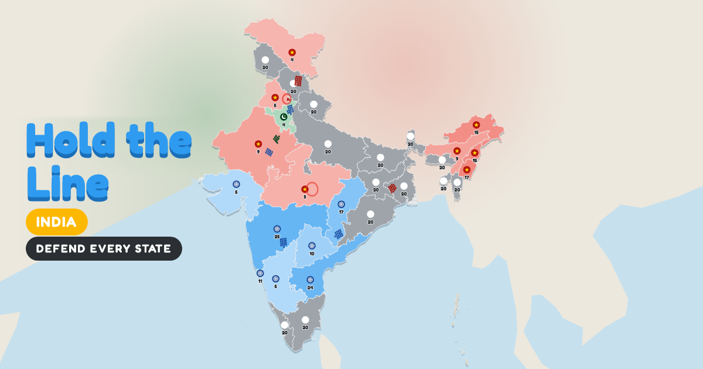

# Hold the Line: India



Invaders are pouring across the borders. Send your troops, take back every
state and defend India.

**[Play now →](https://aayushgarg293.github.io/hold-the-line-india/)**

Free, no sign-up, no ads. Works on phones and computers, and can be added to
your home screen to play offline.

## How to play

- Drag from one of your blue circles to another circle to send its troops.
- Send more troops than a state holds to capture it.
- Your states slowly grow new troops. So do the invaders'.
- Drive every invader off the map to win the level.
- Win without losing a single state for three stars.

## Levels

1. Seven Sisters
2. Western Front
3. Northern Heights
4. Coastal Raid
5. Eastern Gate
6. Two-Front War
7. Battle for Bharat

## Run it yourself

The whole game is one file. Open `index.html` in a browser, or serve the
folder to get offline play too:

```bash
python3 -m http.server
```

## Credits

Map of India from [Simplemaps](https://simplemaps.com).

If you enjoy the game, you can
[buy me a coffee](https://www.buymeacoffee.com/aayushgarg) ☕
